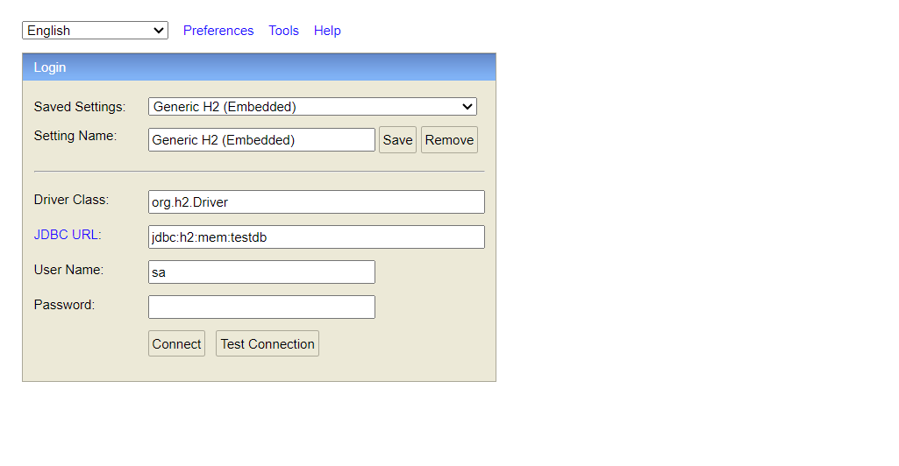
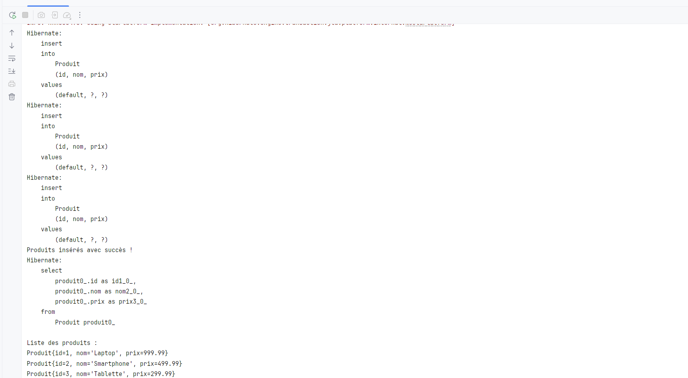
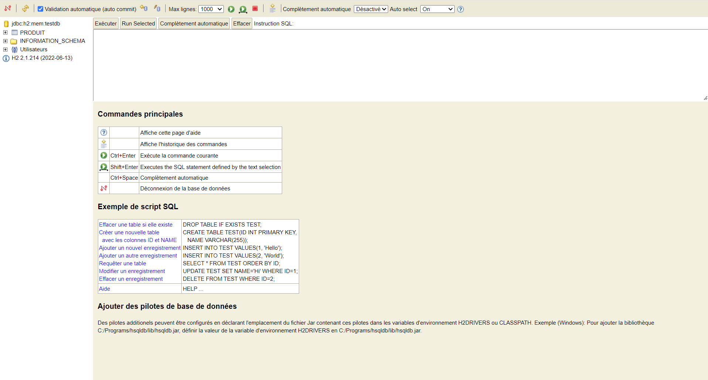

# TP : Introduction à Hibernate / JPA avec H2 Database

Ce projet illustre la mise en place d'une application Java avec l'API **JPA** et l'implémentation **Hibernate**, connectée à une base de données en mémoire **H2**, avec l'activation de la console web de supervision H2.

---

## 1. Configuration Hibernate (`persistence.xml`)

Dans `src/main/resources/META-INF/persistence.xml`, la stratégie de génération de schéma utilise la valeur `update` au lieu de `create-drop` afin de conserver la structure et les données créées pour pouvoir les consulter :

```xml
<!-- Conserver et mettre à jour le schéma sans le supprimer à l'arrêt -->
<property name="hibernate.hbm2ddl.auto" value="update"/>
```

Paramètres de connexion :
- **Driver JDBC** : `org.h2.Driver`
- **JDBC URL** : `jdbc:h2:mem:testdb;DB_CLOSE_DELAY=-1`
- **User Name** : `sa` (mot de passe vide)

---

## 2. Démarrage de la Console Web H2

Pour visualiser la base de données dans un navigateur, le serveur web H2 est démarré au lancement de l'application dans la classe `App` :

```java
import org.h2.tools.Server;

try {
    Server.createWebServer("-web", "-webPort", "8082").start();
    System.out.println("Console H2 disponible sur : http://localhost:8082");
} catch (Exception e) {
    System.out.println("Erreur lors du démarrage de la console H2");
    e.printStackTrace();
}
```

### Accès à la console
Ouvrir le navigateur à l'adresse suivante : [http://localhost:8082](http://localhost:8082)

Paramètres de connexion :
- **Driver Class** : `org.h2.Driver`
- **JDBC URL** : `jdbc:h2:mem:testdb`
- **User Name** : `sa`
- **Password** : *(laisser vide)*



---

## 3. Compilation et Exécution du Projet

### Exécution
Exécuter la classe `App` depuis votre IDE ou via la ligne de commande Maven :

```bash
mvn clean compile exec:java -Dexec.mainClass="com.example.App"
```

### Résultats obtenus
À l'exécution, Hibernate :
1. Génère et exécute les requêtes SQL `INSERT` pour persister les entités `Produit` (`Laptop`, `Smartphone`, `Tablette`).
2. Récupère la liste complète des produits via une requête JPQL (`SELECT p FROM Produit p`).
3. Recherche et affiche les détails du produit ayant l'identifiant `ID=2`.



---

## 4. Visualisation des données dans la Console H2

Après connexion à la console web H2 :
- La table `PRODUIT` créée automatiquement par Hibernate est visible dans le panneau latéral gauche.
- Vous pouvez exécuter des requêtes SQL pour vérifier et manipuler les données insérées :

```sql
SELECT * FROM PRODUIT;
```



> **Remarque :** Avec l'URL `jdbc:h2:mem:testdb`, la base est stockée en mémoire volatile (les données restent accessibles tant que l'application tourne). Pour conserver les données sur le disque dur, utilisez une URL de type fichier : `jdbc:h2:file:./data/testdb`.
